<div align="center">
  
</div>

<br/>

<div align="center">
  <sub>SELF-HOSTED · OPEN SOURCE · WRITTEN IN GO</sub>
  <br/><br/>

  [](https://go.dev)
  [](LICENSE)
  [](https://github.com/hashicorp/yamux)
</div>

---

smuf exposes a local TCP port through a server you control. HTTP tunnels get a subdomain such as `https://myapp.tunnels.example.com`; raw TCP tunnels get a public port. The client and server are separate Go binaries, and [yamux](https://github.com/hashicorp/yamux) carries concurrent streams for each tunnel over one control connection.

```
localhost:3000  ◄─────►  http://a3f1c9d4e2b8.tunnels.example.com:8080
```

smuf does not require a smuf account or a hosted control plane. It also does not remove infrastructure limits: capacity depends on your server, network, hosting provider, and the connection limits you configure.

## When smuf fits

Use smuf when you want to expose a development HTTP service, webhook receiver, or TCP service without deploying that service, and you can provide:

- a publicly reachable server;
- a base domain and wildcard DNS for HTTP tunnels;
- inbound access to the control port and public service ports.

Choose something else if you need UDP, a managed public endpoint without running a server, per-user access control, an encrypted control channel built into the application, or multiple server replicas sharing tunnel state. smuf currently provides none of those.

You bring the domain and the host. A VPS works, as can a machine at home with suitable routing and firewall rules. A hosted platform is only suitable if it supports both raw TCP client connections and wildcard HTTP routing.

<p align="center">
  <a href="assets/demo.svg">
    
  </a>
</p>

## Requirements

For an internet-facing HTTP server:

1. Point both `tunnels.example.com` and `*.tunnels.example.com` to the server. Replace that name with your own base domain.
2. Allow inbound TCP on the control port, default `7000`, and the public HTTP port, default `8080`.
3. For direct automatic HTTPS, also allow public ports `80` and `443`, and configure the HTTP listener on port `80` for ACME HTTP-01 challenges.
4. For raw TCP tunnels, allow every public port in `SMUF_TCP_PORT_RANGE` that you intend to use.

The local application must listen on `localhost` or `127.0.0.1` on the client machine. The client checks each requested local port before opening a tunnel. HTTP mode expects a local HTTP service; `--tcp` forwards arbitrary TCP bytes, not UDP.

Building from source requires Go 1.26.3 or newer, as declared in `go.mod`. The release configuration targets Linux and macOS on amd64 and arm64, and Windows on amd64. The repository does not publish proof of compatibility with other platforms.

## Installation

### Download a binary

The published `v0.4.0` release is neither a draft nor a prerelease. Download the appropriate archive from [Releases](https://github.com/cosmind-rusu/smuf/releases). It provides Linux amd64/arm64, macOS amd64/arm64, and Windows amd64 archives, plus `checksums.txt`. Release archives contain both programs:

| Binary | Where it runs |
|--------|---------------|
| `smuf-server` | The publicly reachable server |
| `smuf` | The machine running the local service |

The release configuration also generates `checksums.txt`. Compare the archive checksum before installing the binaries.

### Build from source

```bash
git clone https://github.com/cosmind-rusu/smuf.git
cd smuf
go build -o smuf-server ./cmd/smuf-server
go build -o smuf ./cmd/smuf
```

### Docker

The included Compose file builds and runs only `smuf-server`. It is an example to edit, not a ready-made public configuration:

1. Replace `SMUF_DOMAIN=tudominio.com` in `docker-compose.yml` with your base domain.
2. Set `SMUF_AUTH_TOKEN` in the shell used to run Compose. Keep a copy for the client.
3. Start the server:

```bash
export SMUF_AUTH_TOKEN="$(openssl rand -hex 32)"
docker compose up -d
```

The file publishes ports `7000`, `8080`, `80`, and `443`. Although it sets `SMUF_TCP_PORT_RANGE=20000-30000`, it does not publish that range to the host, so raw TCP tunnels will not be reachable through Docker until you add the required port mappings. The `./certs` volume persists the ACME cache.

## Quick start with the wizard

Run the server in an interactive terminal:

```bash
./smuf-server --setup
```

The wizard asks for the base domain, generates a 64-character hexadecimal token, and offers automatic HTTPS for non-localhost domains. It saves settings in the user profile. Copy the token before moving to the client.

Run the client on the machine with your local service:

```bash
./smuf --setup
./smuf 3000
```

The client wizard asks for the server address in `host:port` form, the same token, and an optional fixed subdomain. Existing process environment variables take precedence over saved values. See [Configuration](#configuration) for the exact file locations and loading order.

### Quick start without the wizard

On the server, after configuring DNS and firewall rules:

```bash
export SMUF_DOMAIN=tunnels.example.com
export SMUF_AUTH_TOKEN="$(openssl rand -hex 32)"
printf 'Client token: %s\n' "$SMUF_AUTH_TOKEN"
./smuf-server
```

On the client, use the token printed by the server:

```bash
export SMUF_SERVER=tunnels.example.com:7000
export SMUF_AUTH_TOKEN='paste-the-server-token-here'
./smuf 3000
```

With default ports and HTTPS disabled, the client prints a URL like:

```text
  Tunnel ready!

  Local   → http://localhost:3000
  Public  → http://a3f1c9d4e2b8.tunnels.example.com:8080

  Press Ctrl+C to stop
```

The random ID can change when a tunnel is re-created. Request a fixed subdomain if you need a stable name.

## HTTP tunnels

```bash
./smuf 3000                    # One local HTTP service
./smuf 3000 4000 5000          # Three tunnels, each with its own control connection
./smuf --sub myapp 3000        # Request myapp.tunnels.example.com
```

HTTP tunneling uses Go's reverse proxy and supports ordinary requests, streaming responses, Server-Sent Events, long polling, and HTTP upgrades such as WebSocket. The public `Host` header is preserved for the local application.

Custom subdomains contain 1 to 63 lowercase letters, digits, or hyphens, and cannot begin or end with a hyphen. They are allocated on a first-come, first-served basis. When one command opens several HTTP tunnels, `--sub` or `SMUF_SUBDOMAIN` applies only to the first port.

## Raw TCP tunnels

TCP mode is disabled until the server has a valid `SMUF_TCP_PORT_RANGE`:

```bash
# Server environment
export SMUF_TCP_PORT_RANGE=20000-20100

# Client, after the local service is listening
./smuf --tcp 22
```

The server allocates an available port and returns an address such as `tcp://tunnels.example.com:20000`. Publish and allow that port through Docker, cloud firewall rules, and the host firewall. The allocated port can change when a tunnel is re-created.

A TCP tunnel exposes the service without adding application-level authentication or encryption. Enabling SSH or database access this way can create a serious security risk; protect the service itself and restrict source addresses where possible.

## Configuration

smuf reads environment variables, a wizard-written JSON file in the user profile, or a local `.env` file. There is no standalone YAML or TOML configuration file.

### Server variables

| Variable | Default | Purpose |
|----------|---------|---------|
| `SMUF_DOMAIN` | `localhost` | Base domain used for routing and public URLs |
| `SMUF_AUTH_TOKEN` | unset | Shared client token; authentication is disabled when empty |
| `SMUF_CONTROL_PORT` | `7000` | Raw TCP listener for smuf clients |
| `SMUF_HTTP_PORT` | `8080` | Public HTTP listener; also handles ACME and redirects when HTTPS is enabled |
| `SMUF_HTTPS` | `false` | Enable automatic public HTTPS with Let's Encrypt; accepted true values are `1`, `true`, `yes`, and `on`, case-insensitive |
| `SMUF_HTTPS_PORT` | `443` | Public HTTPS listener |
| `SMUF_ACME_EMAIL` | unset | Optional contact for Let's Encrypt notices |
| `SMUF_ACME_CACHE` | `certs` | Directory for certificate state; persist and protect it |
| `SMUF_PUBLIC_HTTP_PORT` | listener port | Port advertised in HTTP URLs when an external mapping differs |
| `SMUF_PUBLIC_HTTPS_PORT` | listener port | Port advertised in HTTPS URLs when an external mapping differs |
| `SMUF_MAX_CONNS_PER_IP` | `5` | Concurrent control connections per source IP; each tunnel uses one |
| `SMUF_CONN_RATE_PER_MIN` | `30` | New control connection attempts per source IP per minute |
| `SMUF_HANDSHAKE_TIMEOUT` | `10s` | Time allowed for the client handshake, using Go duration syntax |
| `SMUF_TCP_PORT_RANGE` | unset | Inclusive raw TCP allocation range, for example `20000-20100`; TCP is disabled when unset or invalid |

The two public-port variables change advertised URLs only. They do not open listeners, configure port forwarding, or change firewall rules. URL formatting omits port `80` or `443` in either mode, so nonstandard combinations such as plain HTTP on port `443` are not represented reliably.

### Client variables

| Variable | Default | Purpose |
|----------|---------|---------|
| `SMUF_SERVER` | `localhost:7000` | Server control address in `host:port` form |
| `SMUF_AUTH_TOKEN` | unset | Token matching the server |
| `SMUF_SUBDOMAIN` | unset | Fixed HTTP subdomain; `--sub` takes precedence |

### Configuration loading order

At startup, each binary applies the first file-based source it finds, without overriding a process environment variable that is already non-empty:

1. `%APPDATA%\smuf\config.json` on Windows, falling back to `%USERPROFILE%\smuf\config.json` when `APPDATA` is unset.
2. `$HOME/smuf/config.json` on other systems.
3. `.env` next to the executable. If that file does not exist, `.env` in the current working directory.

A valid `config.json` stops the search, so a local `.env` is not read afterward. Both wizards use the same profile path. Running the server and client wizards as the same OS user overwrites one JSON file with the other program's settings; use separate users or explicit environment configuration for that setup.

The `.env` parser accepts simple `KEY=VALUE` lines and comments beginning with `#`. It trims surrounding whitespace but does not evaluate shell expressions, expand variables, or remove quotes. Generate a token in the shell first, then paste the resulting value:

```env
SMUF_SERVER=tunnels.example.com:7000
SMUF_AUTH_TOKEN=paste-the-generated-token-here
SMUF_SUBDOMAIN=myapp
```

Do not write `SMUF_AUTH_TOKEN=$(openssl rand -hex 32)` in `.env`; that command would be treated as literal text.

## HTTPS

Set the following on a server with direct public access and working wildcard DNS:

```env
SMUF_DOMAIN=tunnels.example.com
SMUF_HTTP_PORT=80
SMUF_HTTPS=true
SMUF_HTTPS_PORT=443
SMUF_ACME_EMAIL=admin@example.com
SMUF_ACME_CACHE=/var/lib/smuf/certs
```

smuf uses Let's Encrypt HTTP-01 challenges. Port `80` must reach `SMUF_HTTP_PORT`, and port `443` must reach `SMUF_HTTPS_PORT`. Keep the cache across restarts.

The current ACME policy accepts the base domain and every subdomain, not only registered tunnels. A TLS client can vary SNI to trigger certificate issuance attempts, cache growth, and certificate authority quota consumption. This policy needs hardening before a public service. Prefer a trusted reverse proxy with host validation and a wildcard certificate obtained through DNS-01.

Automatic HTTPS protects the visitor-to-server connection. It does not add TLS to the client-to-server control connection. The built-in HTTP-to-HTTPS redirect also constructs its target from the request `Host` without validating it.

A reverse proxy must preserve the wildcard `Host` header needed for tunnel routing while rejecting unrelated hosts, and support upgrades and streaming. smuf derives forwarding headers from the request it receives, so test applications that generate absolute redirects when TLS terminates at an external proxy.

## Dashboard

The base domain serves an unauthenticated dashboard at the public HTTP or HTTPS root, for example `http://tunnels.example.com:8080/`. It refreshes every five seconds and lists tunnel type, public URL, local port, client IP, and creation time. `/_smuf/tunnels` returns the same metadata as JSON and allows cross-origin reads.

There is no dashboard authentication or disable setting in the current server. Treat this metadata as public, or restrict access to the base domain at a reverse proxy without blocking tunnel subdomains.

## Deployment notes and limits

- The server keeps its tunnel registry in memory. Restarting it drops active tunnels; running several replicas does not share or replicate state. The supplied Railway configuration uses one replica.
- The client retries an interrupted tunnel. A random HTTP subdomain or allocated TCP port can change after reconnection, while a fixed subdomain must be available again.
- Control limits apply to smuf client connections, not to visitors making HTTP or raw TCP requests. They are per source IP as observed by the server, so clients behind the same proxy or NAT share a bucket.
- There are no server-wide caps on client or visitor connections, yamux streams, memory, CPU, or bandwidth. The per-IP control limits are not global resource limits; host capacity, file descriptors, and provider quotas still apply.
- There is no UDP forwarding, built-in access control for public visitors, high availability, or persistent tunnel inventory.
- The repository's `railway.json` selects the Docker build and one replica, but does not establish public raw TCP access to port `7000` or wildcard subdomain routing. Verify both in Railway before using the [Railway template](https://railway.com/deploy/high-warm?utm_medium=integration&utm_source=template&utm_campaign=generic). A normal single-host HTTP mapping is not enough for the full protocol.

## Security checklist

- Use the current version for demos or protected personal use, not as a public multi-tenant service.
- Set a long random `SMUF_AUTH_TOKEN`; without it, anyone who can reach the control port can request a tunnel. The wizard generates 32 random bytes and displays them as 64 hexadecimal characters.
- Protect the control connection separately when it crosses an untrusted network. The handshake, including the token, and yamux traffic use raw TCP without application-level TLS. Public HTTPS does not encrypt this hop.
- Assume every exposed HTTP or TCP service is reachable by anyone who can reach its public endpoint. smuf does not replace the application's own authentication, authorization, or protocol encryption.
- Restrict dashboard access if local ports, client IPs, and tunnel URLs should not be public.
- Run the server with a dedicated unprivileged account, persist the certificate cache securely, and open only the ports you use.
- Keep `.env` and `config.json` out of source control and limit their read permissions.

## How it works

```text
smuf 3000  ── raw TCP + yamux ──►  smuf-server :7000
                                      │
                           PORT 3000 SUB myapp
                           OK myapp http://myapp.tunnels.example.com:8080
                                      │
request to myapp.tunnels.example.com ─► yamux stream ─► localhost:3000
```

The client opens one control connection per tunnel. After a text handshake, both sides run yamux on that connection. The server routes HTTP requests by the subdomain in `Host`, or raw TCP connections by their allocated public port, and opens streams to the client. The client copies bytes to `localhost:<port>`. The server never receives a persistent copy of the tunnel registry on disk.

## More documentation

- [Installation and release targets](docs/wiki/Installation.md)
- [Server setup, including systemd](docs/wiki/Server-Setup.md)
- [Client usage](docs/wiki/Client-Usage.md)
- [Configuration reference](docs/wiki/Configuration.md)
- [Architecture](docs/wiki/Architecture.md)
- [Troubleshooting](docs/wiki/Troubleshooting.md)

## Project structure

```text
smuf/
├── cmd/
│   ├── smuf/           # Client
│   ├── smuf-server/    # Server and integration tests
│   ├── test-tcp/       # Manual raw TCP test
│   └── test-websocket/ # Manual WebSocket test
└── internal/
    ├── tunnel/         # In-memory registry and buffered connection
    ├── wizard/         # Interactive setup and configuration loading
    └── logger/         # Timestamped logging
```

## Contributing

Read [CONTRIBUTING.md](CONTRIBUTING.md) before sending a pull request. Report bugs through [GitHub Issues](https://github.com/cosmind-rusu/smuf/issues).

<div align="center">
  
  <br/>
  <sub>Built with Go · <a href="LICENSE">Apache 2.0</a></sub>
</div>
